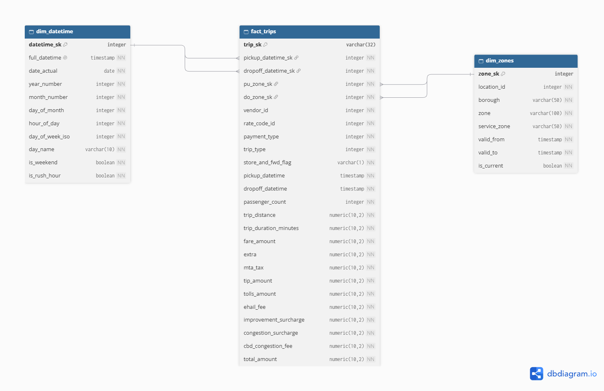

# NYC Mobility Data Warehouse

An end-to-end Data Engineering & Analytics portfolio project built on **PostgreSQL 17**, **Docker**, and **Python**, transforming raw NYC Green Taxi trip records (`2025-11`) into a Kimball-style Dimensional Data Warehouse with OLAP time-series analytics, Slowly Changing Dimensions (Type 2), and B-Tree performance tuning.

## Tech Stack
- **Database:** PostgreSQL 17 (`postgres:17-alpine`)
- **DB Administration:** pgAdmin 4
- **Ingestion:** Python 3.12 (`pyarrow`, `pandas`, `SQLAlchemy`, `psycopg` v3)
- **Containerization:** Docker & Docker Compose
- **SQL Modeling & Analytics:** CTEs, Window Functions (OLAP), Kimball Star Schema, SCD Type 2, `EXPLAIN (ANALYZE, BUFFERS)`
- **Data Modeling:** DBML (`docs/schema.dbml` via dbdiagram.io)

## Project Structure
```text
nyc-mobility-data-warehouse/
├── .env.example
├── .gitignore
├── docker-compose.yaml
├── README.md
├── docs/
│   ├── schema.dbml
│   └── star_schema.png
├── ingestion/
│   ├── Dockerfile
│   ├── ingest_data.py
│   └── requirements.txt
└── sql/
    ├── 01_staging_deduplication.sql
    ├── 02_time_series_analytics.sql
    ├── 03_build_star_schema.sql
    ├── 04_scd_type_2.sql
    └── 05_performance_tuning.sql
```

## Quick Start: Infrastructure & Ingestion

1. **Configure environment variables** (optional, defaults are provided in `docker-compose.yaml`):
   ```bash
   cp .env.example .env
   ```

2. **Start PostgreSQL 17 and pgAdmin 4:**
   ```bash
   docker compose up -d
   ```
   - PostgreSQL is exposed on `localhost:5432` (database: `nyc_mobility`).
   - pgAdmin 4 is available at `http://localhost:8080` (connect to host `db` on port `5432` inside `mobility-network`).

3. **Run the containerized batch ingestion (`ingest` profile):**
   ```bash
   docker compose --profile ingest build ingestion
   docker compose --profile ingest run --rm ingestion
   ```
   The ingestion script streams the NYC Green Taxi Parquet file in 100,000-row chunks via `pyarrow`, normalizes column names to lowercase, and loads raw tables idempotently:
   - `green_taxi_trips`: **46,912** raw rows
   - `taxi_zones`: **265** lookup rows

4. **Run the SQL pipeline in order (`01` through `05`):**
   Execute the scripts sequentially in pgAdmin 4 or via `psql`:
   ```bash
   for f in sql/01_staging_deduplication.sql sql/02_time_series_analytics.sql sql/03_build_star_schema.sql sql/04_scd_type_2.sql; do
     docker exec -i nyc_mobility_db psql -U root -d nyc_mobility < "$f"
   done
   ```
   *(Run `sql/05_performance_tuning.sql` step-by-step to capture `EXPLAIN (ANALYZE, BUFFERS)` before and after index creation.)*

---

## SQL Pipeline Modules

### Module 1: Staging, Cleaning & Deduplication (`sql/01_staging_deduplication.sql`)
Transforms raw bronze tables into typed, validated, deduplicated staging tables (`stg_green_taxi_trips` and `stg_taxi_zones`):
- **Type Enforcement:** Casts floating-point monetary fields (`fare_amount`, `total_amount`, `tip_amount`, `cbd_congestion_fee`, etc.) and `trip_distance` to exact `NUMERIC(10,2)`, timestamps to `TIMESTAMP`, and nullable IDs/counts to `INTEGER`.
- **Semantic NULL Handling:** Imputes missing operational attributes using NYC TLC data dictionary conventions (e.g., `payment_type = 5` for Unknown, `rate_code_id = 99` for Unknown) instead of dropping valid revenue rows.
- **Anomaly Filtering:** Removes out-of-range pickup dates (outside `2025-11`), negative trip durations, and non-positive distances/fares.
- **Deterministic Surrogate Key & Deduplication:** Generates `trip_sk` via `MD5(CONCAT_WS('|', ...))` at the natural trip grain and removes duplicate rows using `ROW_NUMBER() OVER (PARTITION BY ...)` inside a CTE, enforced by a `PRIMARY KEY` constraint on `trip_sk`.

| Layer | Table | Row Count |
| :--- | :--- | ---: |
| Raw | `green_taxi_trips` | 46,912 |
| Staging | `stg_green_taxi_trips` | 44,828 |
| Filtered / Deduplicated | — | 2,084 (incl. 141 duplicates) |
| Staging | `stg_taxi_zones` | 265 |

### Module 2: Time-Series & OLAP Analytics (`sql/02_time_series_analytics.sql`)
Creates two idempotent OLAP views over the staging layer using CTEs and PostgreSQL Window Functions:
- **`vw_daily_time_series_olap`:** Uses a continuous `generate_series` date spine prior to `ROWS BETWEEN 6 PRECEDING AND CURRENT ROW` to prevent calendar-gap distortion on 7-day moving averages, alongside `LAG()`, `LEAD()`, and `NULLIF`-protected Day-over-Day (DoD %) growth.
- **`vw_borough_top_zones_olap`:** Ranks pickup zones within each NYC borough using `DENSE_RANK() OVER (PARTITION BY borough ORDER BY total_revenue DESC)` and calculates intra-borough revenue share, filtering top-3 performers in an outer query block.

### Module 3: Kimball Dimensional Star Schema (`sql/03_build_star_schema.sql` & `docs/schema.dbml`)
Builds the dimensional warehouse layer documented in `docs/schema.dbml`:
- **`dim_datetime` (737 rows):** Hourly time dimension dynamically generated via `generate_series` from `MIN(pickup_datetime)` to `MAX(dropoff_datetime)` (automatically covering cross-midnight month-end dropoffs) with integer smart keys (`YYYYMMDDHH24`), `is_weekend`, and `is_rush_hour` flags.
- **`dim_zones` (265 initial rows):** Geography dimension with an auto-generated identity `zone_sk` decoupled from the NYC TLC `location_id` business key to enable historical tracking (SCD Type 2).
- **`fact_trips` (44,828 rows):** Trip-grain fact table linking **Role-Playing Dimensions** (`pickup_datetime_sk`, `dropoff_datetime_sk` -> `dim_datetime`; `pu_zone_sk`, `do_zone_sk` -> `dim_zones`) with full referential integrity (`100%` staging-to-fact row reconciliation).



### Module 4: Slowly Changing Dimension Type 2 (`sql/04_scd_type_2.sql`)
Upgrades `dim_zones` to a **Type 2 SCD** (`266` rows post-simulation) with `valid_from`, `valid_to` (`9999-12-31 23:59:59` sentinel), and `is_current` columns:
- Enforces single-active-row integrity per business key via a PostgreSQL **Partial Unique Index** (`WHERE is_current = TRUE`).
- Simulates a TLC zone reclassification for `location_id = 74` (`East Harlem North`: `Boro Zone` -> `Yellow Zone` effective `2025-12-01`) inside an atomic transaction (`BEGIN`/`COMMIT`) using `IS DISTINCT FROM` comparison and a CTE anti-join.
- Verified zero historical corruption: all **11,898** November 2025 trips (`$255,420.93`) in `fact_trips` remain accurately linked to `zone_sk = 74` (`Boro Zone`).

### Module 5: B-Tree Indexing & Query Performance Tuning (`sql/05_performance_tuning.sql`)
Creates B-Tree indexes on `fact_trips` Foreign Keys (`pickup_datetime_sk`, `dropoff_datetime_sk`, `pu_zone_sk`, `do_zone_sk`) and temporal filter columns (`pickup_datetime`), followed by `ANALYZE fact_trips` to update Cost-Based Optimizer statistics.

Benchmarked a rush-hour analytical aggregation (`2025-11-12 08:00–10:00`, `pu_zone_sk = 74`) using `EXPLAIN (ANALYZE, BUFFERS)`:

| Metric | Before (`Seq Scan`) | After (`Index Scan`) | Improvement |
| :--- | ---: | ---: | ---: |
| **Execution Time** | `4.478 ms` | `0.922 ms` | **-79.4% (4.86x faster)** |
| **Buffers Touched (8KB pages)** | `1,196` | `101` | **-91.6% I/O** |
| **Rows Discarded by Filter** | `44,741` | `132` | **-99.7%** |
| **Estimated Planner Cost** | `1,838.57` | `281.41` | **-84.7%** |